# Database Design v2 — 19xbet365

**Engine:** PostgreSQL 16  
**System of record:** player accounts, wallet ledger, sportsbook, games, fantasy, payments review, KYC, responsible gaming, support and audit.  
**Rule:** Firebase is the player identity provider. It is **not** the money database. Firestore is not used for balances, bets, rounds, deposits, withdrawals or audit.

## 1. Design principles

1. **PostgreSQL is the authority for money and state.** Every wallet movement, game round, bet, deposit, withdrawal and prize is written in a database transaction.
2. **Append-only evidence.** The wallet ledger, audit chain, login history, settled game rounds, settled bets, settled fantasy entries and fantasy settlements cannot be rewritten.
3. **Business references are idempotent.** A wallet movement is unique per `(account_id, reference_type, reference_id, type)`, preventing double credits and double debits.
4. **Every invariant is enforced as close to the data as possible.** Negative balances, duplicate emails, hierarchy cycles, overlapping prize tiers, invalid fantasy lineups and invalid status transitions are blocked by constraints or triggers.
5. **The application still validates input.** Database guards are the last line of defence, not a replacement for API validation.
6. **Migrations are versioned.** `schema_migrations` records every applied file. `backend/db/migrations/` is append-only; changes get a new migration.
7. **Reconciliation is a query, not a hope.** `wallet_reconciliation` compares each account balance with the sum of its ledger entries.

## 2. Domain map

```mermaid
erDiagram
  ROLES ||--o{ ACCOUNTS : role
  ACCOUNTS ||--o{ ACCOUNTS : parent
  ACCOUNTS ||--o{ SESSIONS : has
  ACCOUNTS ||--o{ LOGIN_HISTORY : records
  ACCOUNTS ||--o{ REFERRALS : referrer
  ACCOUNTS ||--o{ TRANSACTIONS : ledger
  ACCOUNTS ||--o{ BETS : places
  ACCOUNTS ||--o{ GAME_ROUNDS : plays
  ACCOUNTS ||--o{ DEPOSIT_REQUESTS : submits
  ACCOUNTS ||--o{ WITHDRAWAL_REQUESTS : submits
  ACCOUNTS ||--o| ACCOUNT_VERIFICATIONS : verifies
  ACCOUNTS ||--o{ KYC_DOCUMENTS : uploads_metadata
  ACCOUNTS ||--o| RESPONSIBLE_LIMITS : controls
  ACCOUNTS ||--o{ RESPONSIBLE_LIMIT_EVENTS : history
  ACCOUNTS ||--o{ BONUS_GRANTS : receives
  ACCOUNTS ||--o{ NOTIFICATIONS : receives
  ACCOUNTS ||--o{ SUPPORT_TICKETS : opens
  SUPPORT_TICKETS ||--o{ SUPPORT_MESSAGES : contains
  ACCOUNTS ||--o{ FANTASY_ENTRIES : enters
  FANTASY_CONTESTS ||--o{ FANTASY_PRIZE_TIERS : pays
  FANTASY_CONTESTS ||--o{ FANTASY_ENTRIES : contains
  FANTASY_CONTESTS ||--o{ FANTASY_PLAYER_STATS : scores
  FANTASY_CONTESTS ||--o| FANTASY_SETTLEMENTS : settles
  FANTASY_PLAYERS ||--o{ FANTASY_ENTRY_PLAYERS : selected
  FANTASY_ENTRIES ||--o{ FANTASY_ENTRY_PLAYERS : lineup
  MATCHES ||--o{ BET_SELECTIONS : offers
  BETS ||--o{ BET_SELECTIONS : contains
  MATCHES ||--o{ MATCH_ODDS_HISTORY : audits
  GAMES ||--o{ GAME_ROUNDS : played
  ACCOUNTS ||--o{ FAVORITES : saves
  ACCOUNTS ||--o{ RECENT_PLAYS : recent
  PROMOTIONS ||--o{ BONUS_GRANTS : source
  AUDIT_EVENTS }o--|| ACCOUNTS : actor
```



`FANTASY_ENTRY_PLAYERS` is the target normalized lineup table described in section 12; the current implementation stores the lineup in `fantasy_entries.lineup` and validates it with a trigger.

## 3. Schemas by domain

### Identity and hierarchy

| Table | Purpose | Key integrity |
| --- | --- | --- |
| `roles` | Staff/player roles and permission JSONB | unique rank/code |
| `accounts` | Player/staff identity, balance, hierarchy | unique lower(email), lower(username); email format check; balance >= 0; parent cycle trigger |
| `sessions` | Server sessions | unique token hash; expiry/revocation indexes |
| `login_history` | Authentication evidence | append-only trigger |
| `referrals` | Referral ownership and status | one row per referee; referrer/referee FKs |
| `account_invitations` | Master-issued staff credentials | unique token hash; one-time state |
| `account_transfers` | Hierarchy transfer approvals | reviewer/requester FKs |

Firebase fields:

- `accounts.firebase_uid` — partial unique index; one secure identity to one account.
- `accounts.auth_provider` — `password` or `firebase`.
- `accounts.email_verified` — gates deposits and withdrawals.

### Wallet and money

| Table | Purpose | Key integrity |
| --- | --- | --- |
| `transactions` | Append-only player wallet ledger | type check; amount <> 0; unique business reference; update/delete blocked |
| `bonus_grants` | Deposit/promo bonus lifecycle | unique source; non-negative amounts; expiry/status |
| `deposit_requests` | Manual/PSP deposit review | immutable amount/reference after insert; one reference per account; reviewed state guard |
| `withdrawal_requests` | Manual payout review | immutable amount/destination; one open request per account |
| `wallet_reconciliation` | Balance vs ledger view | `balanced` or `mismatch` |

The wallet writes use PostgreSQL row locks (`SELECT … FOR UPDATE`) in `backend/src/services/wallet.js`. Account balance and ledger insert happen in one transaction.

### Sportsbook

| Table | Purpose | Key integrity |
| --- | --- | --- |
| `sports` | Sport catalogue | slug PK |
| `matches` | Fixtures, 1X2 odds, result | sport FK; odds snapshots |
| `match_odds_history` | Odds audit trail | trigger on insert/odds update |
| `bets` | Single/accumulator tickets | settled bets immutable |
| `bet_selections` | Locked selection and result | unique selection per bet; settled result immutable |

The current product exposes the 1X2 market. A future `match_markets` + `market_selections` model can be added without changing the wallet or settlement ledger.

### Casino and originals

| Table | Purpose | Key integrity |
| --- | --- | --- |
| `games` | 44-title catalogue and metadata | category/status indexes |
| `game_rounds` | Server-authoritative rounds | settled/void rounds immutable; one round per reference |
| `favorites`, `recent_plays` | Player catalogue state | composite PKs |

Game outcomes and state are server-side. `state` may contain multi-step hands (for example the blackjack shoe); it is never returned to the client while a hand is open.

### Fantasy cricket

| Table | Purpose | Key integrity |
| --- | --- | --- |
| `fantasy_contests` | Contest config and lifecycle | lock/start/settle timestamps |
| `fantasy_prize_tiers` | Rank ranges and payouts | ranges cannot overlap |
| `fantasy_players` | Player pool and salary | role check; active flag |
| `fantasy_player_stats` | Per-contest points | composite PK |
| `fantasy_entries` | Player lineup and result | lineup validation trigger; settled entries immutable |
| `fantasy_settlements` | One settlement per contest | append-only; unique contest |

The lineup trigger verifies:

- JSONB array, no duplicate players;
- captain and vice-captain are distinct and in the lineup;
- all players exist, are active, match the contest sport and one of the two teams;
- salary cap is respected;
- cricket has 11 players: 1 WK, 4 BAT, 3 AR, 3 BOWL, maximum 7 from one team;
- prize tiers do not overlap.

The application still performs the same validation for friendly error messages.

### KYC, responsible gaming and support

| Table | Purpose | Key integrity |
| --- | --- | --- |
| `account_verifications` | Current KYC case | one per account; reviewed state |
| `kyc_documents` | Document submission history | verification/account FKs; status history |
| `responsible_limits` | Current limits/exclusions | one per account |
| `responsible_limit_events` | Immutable change history | trigger on every limit insert/update |
| `support_tickets`, `support_messages` | Support desk | status/priority checks; ticket index |
| `notifications` | In-app inbox | unread partial index |

### Audit and settings

| Table | Purpose | Key integrity |
| --- | --- | --- |
| `audit_events` | Hash-chained control-room audit | append-only trigger; actor/entity indexes |
| `platform_settings` | Master-only configuration | JSONB value + updater |
| `content_pages` | Legal/help content | published/draft/archive status |
| `schema_migrations` | Applied migration files | unique name |

## 4. Transaction boundaries

| Flow | Rows locked/written together |
| --- | --- |
| Register/Firebase exchange | account, welcome transaction, notification, responsible limits, audit event, session |
| Place bet | account row lock, stake debit, bet, selections, transaction, notification/audit |
| Play game | account row lock, stake debit, game round, settlement payout, transaction, audit |
| Deposit review | deposit request lock, account lock, deposit + bonus ledger, bonus grant, notification, audit |
| Withdrawal request | account lock, balance debit, request, transaction, notification, audit |
| KYC submit/review | verification row, document history, notification, audit |
| Fantasy entry | contest lock, account lock, stake debit, entry + lineup validation, transaction, audit |
| Fantasy settlement | contest lock, all entries lock, scores, prizes, wallet credits, settlement row, audit |
| Sports settlement | fixture locks, selections, bet status, wallet credit, notification, audit |

## 5. Index strategy

- Every foreign key used in filters has a supporting index: `transactions(account_id,type,created_at)`, `bet_selections(match_id,result)`, `fantasy_player_stats(player_id)`, `support_tickets(account_id)`, `kyc_documents(account_id,submitted_at)`.
- Partial indexes are used for hot subsets: open sessions, unread notifications, open game rounds, open withdrawal requests.
- The transaction reference index is unique on `(account_id, reference_type, reference_id, type)` with non-null references. This is the idempotency guard.
- `audit_events(entity_type,entity_id,created_at)` supports entity investigations.
- `matches(sport,status,start_time)` supports lobby/live queries.

## 6. Migrations and deployment

```bash
npm run db:migrate   # apply pending migrations without resetting data
npm run db:seed      # apply schema + all migrations, reset demo data
npm run db:audit     # reconciliation + invariant/trigger checks
```

`backend/db/schema.sql` remains the v1 baseline. All later changes live in `backend/db/migrations/` and are recorded in `schema_migrations`. The seed re-applies migrations in force mode so the baseline schema and migration functions cannot drift.

## 7. Backup, retention and operations

- Use PostgreSQL PITR with encrypted WAL archives; test restore monthly.
- Take daily logical backups; retain audit/settlement/ledger backups according to jurisdiction.
- Run the API with a restricted database role: no DDL, no trigger ownership, no superuser.
- Partition large append-only tables by month once volume requires it: `transactions`, `audit_events`, `login_history`, `game_rounds`, `match_odds_history`.
- Run `wallet_reconciliation` as a scheduled monitor; alert on any `mismatch`.
- Monitor transaction reference duplicate attempts, failed trigger attempts and audit-chain verification.
- Rotate database credentials; keep the Firebase service account (if added) in a secret manager.

## 8. Production gaps intentionally left for later

These are not needed for the current coin product, but must be addressed before real-money scale:

1. **Double-entry ledger.** Current ledger is a player-facing single-entry append-only ledger with reconciliation. A regulated operator should add an operator-side double-entry journal for deposits, withdrawals, fees, bonuses, game liabilities and treasury accounts.
2. **Multi-currency wallets.** A `wallets` table with currency, precision and FX rules is required for multi-currency real money.
3. **PSP integration.** `payment_intents`, provider webhook events, idempotent capture/refund and reconciliation tables are required when a merchant account is connected.
4. **Normalized RBAC.** `roles.permissions` is JSONB; a `permissions` + `role_permissions` model is preferable at enterprise scale.
5. **Normalized fantasy lineups.** `fantasy_entry_players` should become the authoritative lineup table; the current JSONB lineup is validated by a trigger.
6. **Market model.** `match_markets` and `market_selections` for multi-market sportsbook expansion.
7. **Row-level security.** Add RLS for tenant/branch isolation if the platform is deployed as a shared multi-tenant database.
8. **Certified RNG and external audit.** Database constraints cannot certify game maths or regulatory compliance.

## 9. Verification evidence

`backend/db/audit.js` / `npm run db:audit` verifies:

- all accounts reconcile to the ledger;
- no duplicate wallet references;
- required tables and triggers exist;
- direct UPDATE of transactions, settled rounds, settled bets and deposit amount is rejected;
- responsible-limit and odds history are populated;
- migrations are recorded.

Latest run: all checks passed, **30/30 accounts balanced**, **38 odds snapshots**, **1 migration applied**, and mutation attempts rejected by the database.
